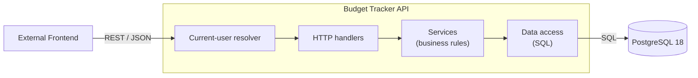
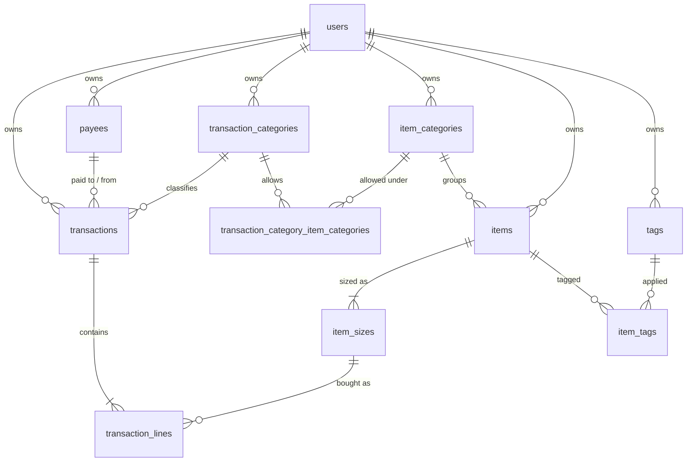

# Budget Tracker API — Design Document

| | |
|---|---|
| **Status** | Version 1 Design |
| **Last updated** | 2026-11-10 |

---

## 1. Overview

**Budget Tracker API** is a web backend API that gives you a clear picture of where your money goes. It records income and expenses, organises them into categories, and shows how spending changes over time.

No frontend for using the API is provided as part of this project.

---

## 2. Goals

### 2.1 Product
- **Store:** record and categorise transactions down to individual line items.
- **Display:** view and filter transactions, with totals.

### 2.2 Quality
- **Data integrity:** the database itself enforces correctness through types, constraints, foreign keys and triggers.
- **Well-defined API:** a consistent REST API documented with OpenAPI.
- **Reliable:** automated tests run in CI on every change.
- **Easy to run locally:** one command starts the stack (`docker compose up`); `uv run poe dev` runs the app outside Docker.
- **Deployable without rework:** moving to a server is a configuration and infrastructure task, never a code or structural change. See [Considerations for Deployment](#113-considerations-for-deployment).

### 2.3 Current Non-goals
- Alerts
- Multiple currencies
- Deployment to a server

---

## 3. Roadmap

### 3.1 Version 1 Roadmap

| Milestone | Focus | Scope |
|---|---|---|
| **Milestone 1** | Foundation | Transactions with line items; item list; transaction categories, item categories, payees and tags; filtering and totals; user system skeleton; database backups |
| **Milestone 2** | Reporting, analytics & budgets | Spending over time, category breakdowns, period comparisons, chart-ready aggregation, richer sorting and filtering; budgets per category and period with actual spending against each budget |
| **Milestone 3** | User system | Registration, login, sessions or tokens, authorisation checks on every resource. Replaces the Milestone 1 stub |
| **Milestone 4** | CSV import & advanced analysis | CSV upload, column mapping, preview, duplicate detection; trends, forecasting, unusual-spending detection. Both share the same Python data libraries (pandas and similar) |

**User system skeleton (Milestone 1):** a `users` table exists and every user-owned table carries `user_id`. Every query is scoped to the current user, who is resolved by a single function. In Milestone 1 that function always returns one seeded default user; there is no login. In Milestone 3 that one function is replaced with real authentication and nothing else needs to change.

---

## 4. Domain Rules

### 4.1 Transactions
- A transaction has: **date**, **transaction category**, **payee** (required), **line items** (at least one), **notes** (optional). There is no separate description field.
- Whether a transaction is income or an expense comes from its **category**.
- The **transaction total is the sum of its line totals**. It is never stored or entered directly.
- Income such as Salary is entered as a single line (for example item "Monthly salary" at size "1 unit").
- Every line's item must belong to an **item category linked to the transaction's category**.

### 4.2 Line Items
- A line has: **item size** (the item and the size bought), **quantity** (decimal, e.g. `1.35` kg), **line total** (the amount paid for that line, always positive), **discounted** (yes/no), **notes** (optional).
- Lines are shown ordered by item category (default) or item name; there is no manual ordering.

### 4.3 Items
- An item is a reusable entry with: **name**, **item category**, **tags** (optional, many per item). Name uniqueness is defined in [Archiving and Deleting](#46-archiving-and-deleting).
- An item has one or more **sizes**, each a separate entry with a **size** (number + unit, required), for example `500 g` or `2 L`. The same item can be bought in several sizes, and each line records the size it was bought in.
- Units are a fixed list: **g, kg, mL, L, each, unit, pack**. `unit` is for things that have no real size.

### 4.4 Categories
- Transaction categories are user-editable and are either income or expense. Defaults: **Salary** (income), **Groceries**, **Rent**, **Bills** (expense).
- Item categories are a separate, user-editable list. Defaults: **Food & Drink**, **Household**, **Personal Care**, **General / Other**.
- Item categories are **linked to transaction categories**, many-to-many: one item category can be linked to several transaction categories. Users can edit the links. Defaults:

  | Transaction category | Linked item categories |
  |---|---|
  | Salary | General / Other |
  | Groceries | Food & Drink, Household, Personal Care |
  | Rent | General / Other |
  | Bills | Household, General / Other |

- A transaction category with **no linked item categories cannot be used** on a transaction.
- Changing links does not affect past transactions. The rule is checked again only when an edited transaction is saved.
- Archived item categories keep their links but are hidden from lists.
- There is no default Refunds category. In Version 1 a refund is recorded as income under a category the user creates. Linking refunds to the original transaction is covered in [Future Ideas](#112-future-ideas).

### 4.5 Payees and Tags
- Both are reusable lists per user.

### 4.6 Archiving and Deleting
- Transaction categories, item categories, payees, items, item sizes and tags can be **archived** and **unarchived**.
- Archived records are hidden from lists by default but still appear on past transactions.
- An item must keep at least one active size, so archiving or deleting its last active size is refused with 409.
- A record that is still referenced **cannot be deleted**; it must be archived instead. A record is referenced when something else uses it (a transaction, a line or an item). Tag and category links are not references: deleting a tag or category removes its links.
- Names of transaction categories, item categories, payees, items and tags are unique per user (ignoring case) including archived records, so you unarchive rather than create a duplicate. An item's sizes are unique within that item.

### 4.7 Users (Skeleton)
- Each user only ever sees their own data. In Milestone 1 every request is scoped to the single default user.

---

## 5. Architecture



- **App:** a stateless FastAPI server.
  - **Handlers:** parse requests and shape responses.
  - **Services:** hold business rules (line totals, the at-least-one-line rule, the at-least-one-size rule, the item-category link rule, archive/delete behaviour, user provisioning).
  - **Data access:** runs hand-written SQL. Services depend on data-access interfaces, not on the SQL implementations, and are given the implementations by their caller; in the API layer, a FastAPI dependency builds them for each request. All the implementations used for one unit of work share a single connection, so the business rules in a service run in one database transaction.
  - **Current-user resolver:** runs in front of every request (the Milestone 1 stub).
- **Database:** the single source of truth; schema managed with versioned migrations.
- **Containers:** Docker Compose runs PostgreSQL and the backend, as described in [Local Development](#96-local-development).
- **CORS:** allowed origins come from `CORS_ALLOWED_ORIGINS`.
- **Configuration:** environment variables, documented in a committed `.env.example`.

---

## 6. Technology Decisions

### 6.1 Backend Language: Python + FastAPI

| | Python + FastAPI | Go + chi + sqlc |
|---|---|---|
| Speed to Milestone 1 | Fast, little boilerplate | Slower, more hand-written code |
| OpenAPI | Generated from code, always in sync | Written by hand or spec-first |
| Validation | Pydantic | Hand-written or a library |
| Type safety | Type hints + mypy strict | Compiled, static |
| Dynamic queries (custom reports) | SQLAlchemy Core composes them safely | sqlc is static SQL only; needs a second tool |
| Data analysis | pandas, NumPy, statsmodels | Very limited |

**Decision:** Python + FastAPI.  
**Why:** analysis beyond plain aggregation (forecasting, trends, unusual-spending detection, statistics) is a core part of the product's future, and CSV import in Milestone 4 benefits from the same libraries. Python is far ahead here. Mypy in strict mode recovers much of the type safety Go would offer.

### 6.2 Database: PostgreSQL 18

| | PostgreSQL | SQLite |
|---|---|---|
| Setup | Needs a server (Docker) | None, a single file |
| Types | Strict; exact `NUMERIC`, real `DATE`/`TIMESTAMPTZ`, native enums | Loose by default; no exact decimal type, no date or enum types |
| Constraints | Foreign keys and CHECKs always enforced | Foreign keys off unless enabled on every connection |
| Reporting (Milestone 2) | `date_trunc`, window functions, CTEs, views | More limited |
| Concurrency (Milestone 3) | Many writers | One writer at a time |
| Deployment later | Matches hosted platforms | Likely needs migrating |

**Decision:** PostgreSQL 18.  
**Why:** strict types and enforced constraints, strong reporting features for Milestone 2, room for multiple users in Milestone 3, and built-in `uuidv7()`. Since Docker Compose is already part of the plan, the setup cost is mostly paid.

### 6.3 Data Access and Migrations
- **Data access:** SQLAlchemy Core + psycopg 3, with hand-written SQL and light tooling; **no ORM**.
- **Migrations:** Alembic.
- **Concurrency:** sync endpoints (plain `def`, never `async def`, so blocking database calls never run on the event loop) and a sync engine: simpler to write, debug and test, and plenty fast for this app.

### 6.4 Custom Reports (Future)
User-defined reports are built as **SQL aggregation in PostgreSQL**. A report definition is saved as JSON (dimensions, measures, filters, date grouping) and turned into a **parameterised query using allow-listed columns**; users never write SQL. Python data libraries are reserved for analysis SQL handles poorly, such as forecasting and statistics.

### 6.5 Tooling
- **Environments:** uv for Python versions, environments and the lockfile.
- **Validation:** Pydantic, with camelCase aliases on the wire.
- **Linting and types:** ruff for linting and formatting; mypy in strict mode.
- **Tests:** pytest.
- **Project tasks:** Poe the Poet, outlined in [Tooling (Engineering Practice)](#92-tooling).
- **Continuous integration:** GitHub Actions runs the pipeline described in [Continuous Integration](#93-continuous-integration).

---

## 7. Data Model



### 7.1 Constructs

| Construct | Name | Description |
|---|---|---|
| `Enum` | `category_type` | Whether a transaction category is `income` or `expense` |
| `Enum` | `size_unit` | The units an item size can use |
| `Table` | `users` | Owners of all user data. One seeded row in Milestone 1 |
| `Table` | `transaction_categories` | User's categories for transactions, each either income or expense |
| `Table` | `item_categories` | User's categories for items |
| `Table` | `transaction_category_item_categories` | Links transaction categories to the item categories allowed under them |
| `Table` | `payees` | User's list of who a transaction is paid to or received from |
| `Table` | `tags` | User's labels that can be applied to items |
| `Table` | `items` | User's entries for things that are bought, each in an item category, with one or more sizes |
| `Table` | `item_sizes` | The sizes an item can be bought in. Transaction lines point at a size |
| `Table` | `item_tags` | Links items to the tags applied to them |
| `Table` | `transactions` | A user's dated transaction with a category, a payee and optional notes. Its total comes from its lines |
| `Table` | `transaction_lines` | The lines of a transaction: an item size, quantity, line total, discount flag and optional notes |
| `View` | `transaction_totals` | Each transaction with its total, the sum of its line totals |
| `View` | `items_information` | Each item size with its item and item tags information |

### 7.2 Decisions
- **Keys:** every table has a single-column primary key `id` of type **`uuid`**, defaulting to **`uuidv7()`** (time-ordered, so indexes stay compact). Composite primary keys are not used; pairs that must be unique get a `UNIQUE` constraint.
- **Audit columns:** every table has `created_at` and `updated_at` (`TIMESTAMPTZ`). A `set_updated_at()` trigger on every table keeps `updated_at` current on each update, so no query can forget it.
- **Money:** stored as `NUMERIC(12,2)`, never a float. PostgreSQL's `MONEY` type was rejected: its formatting and precision depend on the database's `lc_monetary` setting, it stores no currency, and drivers return it as formatted strings. Multi-currency support would add a `currency_code CHAR(3)` column later.
- **Dates:** `DATE` for when a transaction happened; `TIMESTAMPTZ` for audit fields.
- **Deleting:** `RESTRICT` on anything still referenced (archive it instead); `CASCADE` for a transaction's lines, an item's sizes, tag links and category links. Removing a category link is always allowed.
- **Users:** can't be deleted while they own any data (`RESTRICT`). What account deletion should do is decided in Milestone 3.
- **Names:** all names are `NOT NULL` and can't be blank: `CHECK (btrim(name) != '')`.
- **Constraint names:** unique indexes and `CHECK` constraints are named explicitly (e.g. `payees_user_id_name_key`, `transaction_lines_quantity_positive`), so the API can map database errors to responses by name. A refused `RESTRICT` delete is reported by PostgreSQL as `restrict_violation` (SQLSTATE 23001), not `foreign_key_violation` (23503).
- **At least one line per transaction:** enforced in the service layer, inside one database transaction. A deferred trigger can be added later.
- **Item-category link rule:** every line's item category must be linked to the transaction's category. This is enforced in the service layer, in the same database transaction as the at-least-one-line rule. When it is checked is defined in [Categories](#44-categories). A trigger can be added later.
- **Archiving:** uses a nullable `archived_at` timestamp.
- **Immutable user ownership:** user ids in user-owned tables are made immutable to ensure that the ownership of the data can not change.
- **User matching:** composite foreign keys are used for direct links between user-owned tables, while transitive links are trigger-enforced with single-column foreign keys to check that the referenced row exists.

---

## 8. API Design

All endpoints sit under **`/api/v1`** and are scoped to the current user.

### 8.1 Lookup Resources
`transaction-categories`, `item-categories`, `payees`, `tags`, `items`

Item responses include their `sizes`. `POST /items` takes `sizes` (at least one, otherwise 422). Sizes are managed as a sub-resource at `/items/{itemId}/sizes`, with the same methods, archive endpoints and 409 rule as the lookup resources. Archiving or deleting an item's last active size returns 409.

| Method | Path | Notes |
|---|---|---|
| GET | `/{resource}` | `?q=` name search; archived hidden unless `?includeArchived=true`. Item categories also take `?transactionCategoryId=` (only linked ones). Items also take `?itemCategoryId=`, `?tagId=` and `?transactionCategoryId=` |
| POST | `/{resource}` | Create. 409 if the name exists (archived records included). Transaction categories accept `itemCategoryIds` |
| GET | `/{resource}/{id}` | Transaction categories include `itemCategoryIds` |
| PATCH | `/{resource}/{id}` | Update fields. 409 if the name exists on a different resource. Items accept `tagIds` (updates the links as required); transaction categories accept `itemCategoryIds` (updates the links as required). Any `archived`/`archivedAt` field is **ignored** |
| DELETE | `/{resource}/{id}` | 409 if still referenced |
| POST | `/{resource}/{id}/archive` | Explicit archive |
| POST | `/{resource}/{id}/unarchive` | Explicit unarchive |

### 8.2 Transactions

| Method | Path | Notes |
|---|---|---|
| GET | `/transactions` | Filters `from`, `to`, `transactionCategoryId`, `type`; paging `page`, `pageSize`. Newest first. Rows include date, payee, category, total and line count |
| POST | `/transactions` | Transaction and lines saved together in one database transaction. 422 if there are no lines, or if a line's item category is not linked to the transaction category (one `errors` entry per offending line) |
| GET | `/transactions/summary` | Same filters as the list; returns `incomeTotal`, `expenseTotal`, `net` |
| GET | `/transactions/{id}` | Full transaction including lines |
| PUT | `/transactions/{id}` | Replaces the whole transaction, lines included. Same 422 rules as POST |
| DELETE | `/transactions/{id}` | Lines are deleted with it |

### 8.3 Other

| Method | Path | Notes |
|---|---|---|
| GET | `/units` | The fixed list of units |
| GET | `/me` | The current user (the Milestone 1 stub) |

### 8.4 Health
At the root, outside `/api/v1`, and designed for use by a load balancer or orchestrator:

| Method | Path | Notes |
|---|---|---|
| GET | `/health/live` | Checks if the process responds. Does not check any subsystems, so a database outage never restarts the app |
| GET | `/health/ready` | Checks the health of each subsystem. 200 when all pass, 503 when any fail |

Each readiness check has a 2-second deadline, enforced by a `connect_timeout` on the connection and a `statement_timeout` on the check query.

### 8.5 Example: Create a Transaction

```json
POST /api/v1/transactions
{
  "occurredOn": "2026-10-23",
  "transactionCategoryId": "0192f0c4-…",
  "payeeId": "0192f0c4-…",
  "notes": null,
  "lines": [
    { "itemSizeId": "0192f0c4-…", "quantity": "2", "lineTotal": "3.50", "isDiscounted": true, "notes": null },
    { "itemSizeId": "0192f0c4-…", "quantity": "1.35", "lineTotal": "2.70", "isDiscounted": false, "notes": "loose" }
  ]
}
```

### 8.6 Paged List Response

```json
{ "items": [ … ], "page": 1, "pageSize": 25, "totalItems": 213, "totalPages": 5 }
```

### 8.7 Conventions
- **camelCase JSON on the wire** and in query parameters; the Python code stays snake_case (Pydantic `alias_generator=to_camel`, `populate_by_name=True`).
- **Money and quantities are strings** (`"3.50"`) to avoid floating-point errors in JSON clients such as JavaScript.
- **Dates** are ISO-8601 (`2026-10-23`).
- **Paging:** paged endpoints accept a `pageSize` query parameter, which defaults to 25.
- **Errors** use RFC 9457 `application/problem+json`: `type`, `title`, `status`, `detail`, plus an `errors` array of field-level problems.
  - The exception is `GET /health/ready` (at the root, outside `/api/v1`): it returns the same health body for both 200 and 503, with any failing check marked, so monitors only read one shape.
- **Status codes:**

  | Code | Used for |
  |---|---|
  | 200 | Successful read or update |
  | 201 | Created, with a `Location` header |
  | 204 | Successful delete, archive or unarchive |
  | 404 | Not found, **including another user's records** (never reveals they exist) |
  | 409 | Duplicate name, record still in use, or an action that would leave an item with no active size |
  | 422 | Validation failure |

### 8.8 OpenAPI
- FastAPI serves `/openapi.json` and interactive docs at `/docs`.
- An exported **`openapi.json` is committed** to this repo; CI fails if it no longer matches the code.

---

## 9. Engineering Practice

### 9.1 Testing (pytest)
- **Service tests:** unit tests of the business rules in the service layer, with fake implementations of the data-access interfaces so no database is needed. The rules they cover are defined in [Domain Rules](#4-domain-rules).
- **API and integration tests:** run FastAPI's test client against a **real PostgreSQL 18** started by testcontainers, with Alembic migrations applied. Each test runs in an outer transaction that is rolled back. Service transactions run as savepoints inside it, so their commits are rolled back too.
- **Database-constraint tests:** cover the rules the database itself enforces, as listed in [Decisions](#72-decisions).
- **Migration round-trip test:** an upgrade to head, a downgrade to base, then another upgrade.

### 9.2 Tooling
- **Poe tasks:** run with `uv run poe <task>`, defined in `pyproject.toml`:
  - `check`: runs every quality gate (lint, then test).
  - `lint`: checks linting, formatting and types with ruff and mypy.
  - `format`: fixes auto-fixable lint issues, then formats the code.
  - `test`: runs pytest with coverage. Extra arguments go to pytest.
  - `migrate`: runs Alembic, by default `upgrade head`.
  - `dev`: runs the API locally with auto-reload, outside Docker.
  - `build-label`: prints the build label for the current commit.
  - `seed` (planned): seeds the default user's data.
  - `export-openapi` (planned): exports `openapi.json`.
  - `backup` (planned): dumps the database to a timestamped file.
  - `restore` (planned): loads a chosen dump back into the database.

### 9.3 Continuous Integration
- **Backend pipeline:** ruff → mypy → pytest → OpenAPI drift check → Docker image build → image smoke test.
- **Image smoke test:** the built image is started against PostgreSQL, the migrations run as a one-off step, and `/health/ready` must return 200, so local-only assumptions are caught before they reach a deployment.
- **Coverage:** pytest-cov reports it and never fails the build. CI raises a `::warning::` annotation when coverage is below **70%**.
- **Pre-commit hooks:** none; checks run in CI only.

### 9.4 Git Workflow
- **Branching:** GitLab Flow with environment branches (`main` → `staging` → `production`).
  - Short-lived feature branches are merged to `main` through pull requests.
  - `staging` holds what is being verified for release; `production` holds what is released.
  - Changes only move downstream. Nothing is committed directly to `staging` or `production`.
- **Promotion:** the next branch is fast-forwarded to the commit being promoted (`git push origin main:staging`, then `git push origin staging:production`). Force-pushes are blocked, so only fast-forwards are possible and `production` always contains exactly the commits verified on `staging`. GitHub pull requests can't fast-forward, so promotion is a push, not a PR.
- **Fixes go upstream first:** a fix is merged to `main` and promoted like any other change, then released as a patch. There are no hotfix branches; if `main` holds unreleased work that must not ship yet, it is finished or reverted before the fix is promoted. This decision may be reviewed and changed if that proves impractical.

### 9.5 Versioning
- **Releases:** a [Semantic Versioning](https://semver.org) version (`MAJOR.MINOR.PATCH`).
  - MAJOR for changes that break existing API clients.
  - MINOR for backwards-compatible features.
  - PATCH for backwards-compatible fixes.
- **Before 1.0:** `0.x` versions are pre-release, and the API is not considered stable until `1.0.0`; any `0.x` release may break it.
  - Each finished roadmap milestone is a minor release (Milestone 1 → `0.1.0`, Milestone 2 → `0.2.0`, …), and fixes between milestones are patch releases (e.g. `0.2.1`).
  - `1.0.0` is the Version 1 release, made up of the roadmap milestones. It is released once those milestones are complete and the API is declared stable.
- **API URL version:** the `/api/vN` prefix matches the release's MAJOR version, so it changes only with a major release. Releases before `1.0.0` use `/api/v1`.
- **Old API versions:** after a new major version is released, old versions keep being served.
- **Deprecation process:**
  - An old API version endpoint may be marked as deprecated.
  - Once marked, the endpoint's responses carry a `Deprecation` header ([RFC 9745](https://www.rfc-editor.org/rfc/rfc9745)).
  - Once a removal date is set, the endpoint's responses also carry a `Sunset` header with that date ([RFC 8594](https://www.rfc-editor.org/rfc/rfc8594)).
- **Single source:** the version is set only in `pyproject.toml`. The app, `/health` endpoints and `openapi.json` read it from there.
- **Build labels:** a label identifies every build, using semver pre-release and build-metadata suffixes:

  | Build | Label | Example |
  |---|---|---|
  | Any commit on `main` | `X.Y.Z-dev.N+SHA`, where N is the number of commits since the last tag | `0.2.0-dev.47+1a2b3c4` |
  | Promoted to `staging` | `X.Y.Z-rc.N`, from tag `vX.Y.Z-rc.N` | `0.2.0-rc.1` |
  | Promoted to `production` | `X.Y.Z`, from tag `vX.Y.Z` | `0.2.0` |

  - The image is built once per commit and promoted by adding tags, never rebuilt, so production runs the image that was verified on staging.
  - The dev label is computed at build time from `git describe` (`uv run poe build-label`) and passed into the image as the `APP_BUILD` build argument; `/health` endpoints report it as `build` alongside `version`. Docker image tags can't contain `+`, so image tags use `_` in its place (e.g. `budget-api:0.2.0-dev.47_1a2b3c4`). `openapi.json` keeps the plain version so the drift check doesn't change on every commit.
- **Release process:**
  1. A `Release X.Y.Z` pull request on `main` sets the version in `pyproject.toml`, re-exports `openapi.json` and moves the changelog's `Unreleased` section under the new version and date.
  2. `main` is promoted to `staging` and the commit is tagged `vX.Y.Z-rc.N`. A fix found on staging goes to `main` and is promoted again as the next release candidate.
  3. Once verified, `staging` is promoted to `production` and the same commit is tagged `vX.Y.Z`.
  4. A follow-up pull request moves `main` to the next minor version, so later dev builds sort after the release.
- **Tags:** annotated tags named `vX.Y.Z` or `vX.Y.Z-rc.N`, never moved or deleted.
- **Changelog:** `CHANGELOG.md` follows [Keep a Changelog](https://keepachangelog.com). Each pull request adds its user-visible changes under `Unreleased`; breaking changes go under their own **Breaking** heading.

### 9.6 Local Development
- **Docker Compose:** `docker compose up` starts **postgres:18** (data in a named volume) and the **backend with auto-reload**.
- **Configuration:** `.env` values, as described in [Architecture](#5-architecture).
- **Migrations:** a command runs them.
- **Seeding:** `provision_user()` creates a user's default transaction categories, item categories and the links between them. The Milestone 1 seed script calls it for the default user; Milestone 3 registration reuses it.

### 9.7 Backups
- **Backup (planned):** `uv run poe backup` runs `pg_dump -Fc` and writes `backups/db_backup_<timestamp>.dump`. The `backups/` folder is git-ignored. The timestamp uses the ISO 8601 basic format (`yyyymmddTHHMMSS`).
- **Restore (planned):** `uv run poe restore <file>` loads the named dump into the database. It refuses to overwrite an existing database unless `-f` or `--force` is given.
- **Stopping the app:** recommended before a restore if the app is running.
- **Documentation:** the README documents both and recommends backing up regularly.

---

## 10. Risks

| Risk | Mitigation |
|---|---|
| The item list fills with near-duplicates ("Milk 2L" vs "Milk 2 L") | Case-insensitive unique item names, sizes held under one item, search, archiving; merging items as a future option. Unique names don't catch spelling variants such as "Milk 2 L" |
| Triggers add behaviour that is hidden from the application code | Database-constraint tests |
| Losing data | Backup and restore scripts, documented in the README |
| Dependency on PostgreSQL 18 for `uuidv7()` | Compose image pinned to `postgres:18` |
| Local-only shortcuts creep in and block deployment | Deployment-readiness rules in [Considerations for Deployment](#113-considerations-for-deployment), an environment-neutral `compose.yaml`, the CI image smoke test |
| The triggers for transitive tables linking two user-owned tables are not re-checked when the owning row changes or is inserted later in the same transaction | The user id in user-owned tables are immutable preventing them from changing after the trigger has verified them |
| User accounts need to be merged | Drop user id immutability and replace the triggers for transitive tables linking two user-owned tables with composite foreign keys |

---

## 11. Future

### 11.1 Deferred Decisions

| Question | When it matters |
|---|---|
| Authentication approach: cookie sessions or tokens, password hashing, replacing the stub resolver | Milestone 3 |
| Whether CSV imports and heavy analysis run inside the request or as background jobs | Milestone 4 |
| Deployment target and pipeline behind the `staging` and `production` branches | Later |
| Enforcing the at-least-one-line and item-category link rules with database triggers as well | Any time |

### 11.2 Future Ideas
- Refunds linked to the original transaction.
- Merging near-duplicate items.
- User-defined custom reports.
- Recording the amount saved on discounted items.
- Multiple currencies (`currency_code`).
- Grouping payees into income and expense.
- Alerts: notifications when spending nears or goes over a budget.

### 11.3 Considerations for Deployment
- **One image, every environment:** environments differ only in environment variables and Compose overlays; the app has no dev-only code paths.
- **Config from the environment only:** secrets are never in the image or the repo, `.env` is a local convenience, and missing or invalid settings stop the app at startup.
- **Stateless process:** no state outside the database, no writes to local disk, and logs go to stdout.
- **Runs behind a reverse proxy:** the proxy terminates TLS; the app trusts forwarded headers only from configured proxy addresses.
- **Migrations are a separate one-off step:** run from the same image, never on app startup, and each one stays compatible with the previous release's code (expand, then contract).
- **Database is just a `DATABASE_URL`:** the same code works with a Postgres container or a managed service; TLS options go in the URL.
- **Health checks and graceful shutdown:** liveness and readiness follow orchestrator conventions ([Health](#84-health)), and in-flight requests finish on SIGTERM.
- **Compose layering:** `compose.yaml` is environment-neutral (no published ports, bind mounts or reload), `compose.override.yaml` adds dev conveniences, and a future production overlay adds only the image reference, proxy and restart policies.

### 11.4 Known Issues
- The [Domain Rules](#4-domain-rules) don't outline level or levels of the architecture they are enforced in. This makes it harder to know where the rules need to be enforced and should be document better.
- The [API Design](#8-api-design) is still rather fuzzy about a lot of the details. This should be tightened up as the endpoints are actually created and their functionality is finalized.
