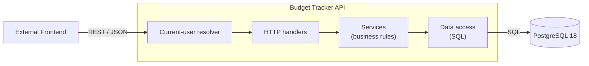
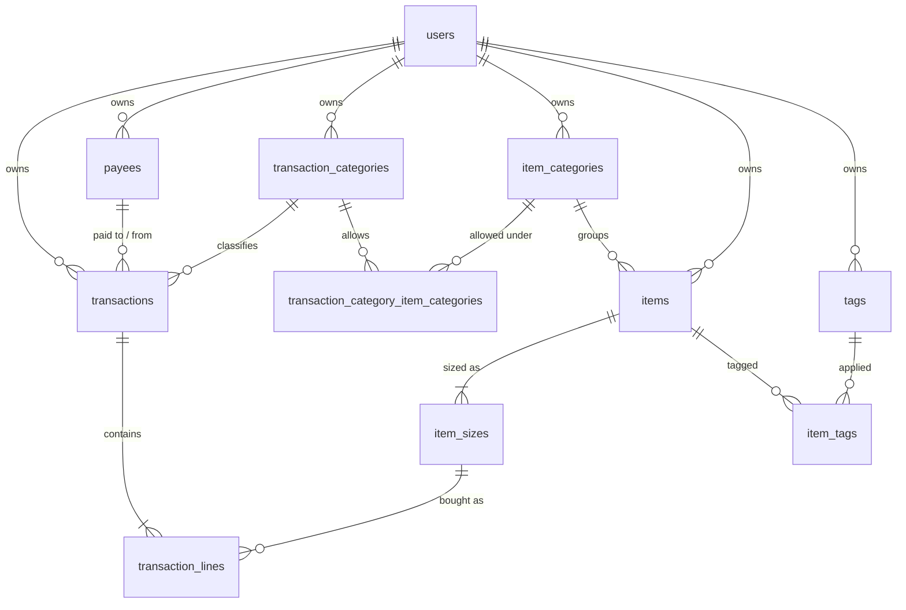

# Budget Tracker API — Design Document

| | |
|---|---|
| **Status** | Version 1 Design |
| **Last updated** | 2026-11-23 |

---

## 1. Overview

**Budget Tracker API** is a web backend API that gives you a clear picture of where your money goes. It records income and expenses, organises them into categories, and shows how spending changes over time.

No frontend for using the API is provided as part of this project.

---

## 2. Goals

### 2.1 Product
- **Store:** record and categorise transactions down to individual line items.
- **Display:** view and filter transactions, with totals.

### 2.2 Quality
- **Data integrity:** the database itself enforces correctness through types, constraints, foreign keys and triggers.
- **Well-defined API:** a consistent REST API documented with OpenAPI.
- **Reliable:** automated tests run in CI on every change.
- **Easy to run locally:** one command starts the stack (`docker compose up`); `uv run poe dev` runs the app outside Docker.
- **Deployable without rework:** moving to a server is a configuration and infrastructure task, never a code or structural change. See [Considerations for Deployment](#113-considerations-for-deployment).

### 2.3 Current Non-goals
- Alerts
- Multiple currencies
- Deployment to a server

---

## 3. Roadmap

### 3.1 Version 1 Roadmap

| Milestone | Focus | Scope |
|---|---|---|
| **Milestone 1** | Foundation | Transactions with line items; item list; transaction categories, item categories, payees and tags; filtering and totals; user system skeleton; database backups |
| **Milestone 2** | Reporting, analytics & budgets | Spending over time, category breakdowns, period comparisons, chart-ready aggregation; richer sorting and filtering, including record and impact counts on lookup lists, most-used ordering and a fuller transaction list; manual line ordering; budgets per category and period with actual spending against each budget |
| **Milestone 3** | User system | Registration, login, sessions or tokens, authorisation checks on every resource. Replaces the Milestone 1 stub |
| **Milestone 4** | CSV import & advanced analysis | CSV upload, column mapping, preview, duplicate detection; trends, forecasting, unusual-spending detection. Both share the same Python data libraries (pandas and similar) |

**User system skeleton (Milestone 1):** a `users` table exists and every user-owned table carries `user_id`. Every query is scoped to the current user, who is resolved by a single function. In Milestone 1 that function always returns one seeded dummy user; there is no login. In Milestone 3 that one function is replaced with real authentication and nothing else needs to change.

---

## 4. Domain Rules

Each rule ends with where it is enforced, using the layers in [Architecture](#5-architecture): the current-user resolver, HTTP handlers (including request validation), services, data access and the database. Where another layer checks a rule before the layer that enforces it, so the client gets a clear error, that layer is named under *Checked first in*. Guides that nothing enforces are in [Guidance](#48-guidance).

### 4.1 Transactions
- A transaction has a **date**, a **transaction category** and a **payee**, all required, and optional **notes**. There is no separate description field. *Enforced in: Database. Checked first in: HTTP handlers.*
- A transaction has at least one **line item**. *Enforced in: Services. Checked first in: HTTP handlers.*
- Whether a transaction is income or an expense comes from its **category**. *Enforced in: Database.*
- The **transaction total is the sum of its line totals**. It is never stored or entered directly. *Enforced in: Database.*
- Totals over a set of transactions give the **income total**, the **expense total** and the **net**, which is income minus expense. *Enforced in: Data access.*
- Transactions are listed newest first by date; transactions on the same date are listed most recently created first. *Enforced in: Data access.*
- A transaction can be deleted, and its lines are deleted with it. *Enforced in: Database.*
- Every line's item must belong to an **item category linked to the transaction's category**. *Enforced in: Services.*

### 4.2 Line Items
- A line has an **item size** (the item and the size bought), a **quantity** (decimal, e.g. `1.35` kg), a **line total** (the amount paid for that line), whether it was **discounted** (yes/no) and optional **notes**. *Enforced in: Database. Checked first in: HTTP handlers.*
- A line kept when its transaction is edited stays the same line, even if its values change. *Enforced in: Services.*
- Several lines of a transaction can use the same item size. *Enforced in: Database.*
- Quantity is always positive, and has at most 12 digits, 3 of them decimal places. *Enforced in: Database. Checked first in: HTTP handlers.*
- A line total is zero or more, so a free item can be recorded, and has at most 12 digits, 2 of them decimal places. *Enforced in: Database. Checked first in: HTTP handlers.*
- Lines are shown ordered case-insensitively by item category, then item name (default), or by item name, with ties kept in the order the lines were added, and lines added together in the order they were given; manual ordering is planned to be part of Milestone 2 as shown in the [Version 1 Roadmap](#31-version-1-roadmap). *Enforced in: Data access.*

### 4.3 Items
- An item is a reusable entry with a **name**, an **item category** and optional **tags** (many per item). Name uniqueness is defined in [Archiving and Deleting](#46-archiving-and-deleting). *Enforced in: Database. Checked first in: HTTP handlers.*
- An item has one or more **sizes**, so the same item can be bought in several sizes, and an active item always has at least one active size. *Enforced in: Services. Checked first in: HTTP handlers.*
- Each size is a separate entry with a positive number, of at most 12 digits, 2 of them decimal places, and a unit, for example `500 g` or `2 L`. *Enforced in: Database. Checked first in: HTTP handlers.*
- Units are a fixed list, in this order: **g, kg, mL, L, each, unit, pack**. `unit` is for things that have no real size. *Enforced in: Database. Checked first in: HTTP handlers.*
- An item's sizes are listed by unit, in the order above, then by value. *Enforced in: Data access.*

### 4.4 Categories
- Transaction categories are user-editable and are either income or expense. *Enforced in: Database. Checked first in: HTTP handlers.*
- Whether a transaction category is income or expense can't be changed after it is created. *Enforced in: Database. Checked first in: Services.*
- Item categories are a separate, user-editable list. *Enforced in: Database.*
- Item categories are **linked to transaction categories**, many-to-many: one item category can be linked to several transaction categories, and users can edit the links. *Enforced in: Database.*
- An item category is created and saved with at least one linked transaction category. It can be left with no active links when its linked transaction categories are archived, or with none when they are deleted. *Enforced in: Services. Checked first in: HTTP handlers.*
- A new user is given default categories and links: transaction categories **Salary** (income), **Groceries**, **Rent** and **Bills** (expense), and item categories **Food & Drink**, **Household**, **Personal Care** and **General / Other**, linked as below. *Enforced in: Services.*

  | Transaction category | Linked item categories |
  |---|---|
  | Salary | General / Other |
  | Groceries | Food & Drink, Household, Personal Care |
  | Rent | General / Other |
  | Bills | Household, General / Other |

- Changing links does not affect past transactions. When an edited transaction is saved, the [Transactions](#41-transactions) rule that every line's item category is linked to the transaction's category is checked again only for lines that are new or whose item size changed, or for every line if its transaction category changed. For that check, the links of an archived transaction category that the transaction already holds still count. *Enforced in: Services.*
- Archiving either category leaves the links between them in place. A link applies only while both of its categories are active, apart from the edited-transaction case above, so it comes back once both are unarchived, in either order. *Enforced in: Services and Data access.*

### 4.5 Payees and Tags
- Both are reusable lists per user. *Enforced in: Database.*

### 4.6 Archiving and Deleting
- Transaction categories, item categories, payees, items and item sizes can be **archived** and **unarchived**. Tags are deleted instead. *Enforced in: Services.*
- An archived record keeps the time it was archived, and unarchiving clears it. *Enforced in: Database.*
- Archived records are hidden from lists by default but still appear on past transactions. *Enforced in: Data access.*
- An archived record can't be newly used on a transaction. *Enforced in: Services.*
- A transaction that already uses an archived transaction category, payee or item size keeps it when edited; an archived item size stays only on a line that keeps it, and only while the transaction's category is unchanged. *Enforced in: Services.*
- Archived records can't be edited; they must be unarchived first. *Enforced in: Database. Checked first in: Services.*
- Links can't be added or removed while either of their categories is archived, except that deleting a category removes its links, as detailed below. *Enforced in: Database. Checked first in: Services.*
- Archiving cascades down from item categories to items to item sizes, and unarchiving restores what was archived with it. Records archived by a cascade get the same archive time as the record that started the cascade. *Enforced in: Services.*
- An item can't be created in, or unarchived while in, an archived item category. *Enforced in: Services.*
- A size's value and unit never change; a different value or unit is a different size. *Enforced in: Database.*
- A size used by a transaction line is never deleted. *Enforced in: Database. Checked first in: Services.*
- Removing a size deletes it, or archives it if a transaction line uses it; changing a size removes it and adds the new one; adding a size that matches an archived one unarchives it. *Enforced in: Services.*
- A record that is still referenced **cannot be deleted**; it must be archived instead. A record is referenced when something else uses it (a transaction, a line or an item); links, including a tag's links to items, don't count. *Enforced in: Database.*
- An active transaction category can't be deleted while it is linked to an active item category. *Enforced in: Database. Checked first in: Services.*
- Apart from the rule above, links don't block a delete: deleting a transaction category, an item category or a tag removes its links. *Enforced in: Database.*
- Names of transaction categories, item categories, payees, items and tags are unique per user (ignoring case). Archived records are included, so you unarchive rather than create a duplicate. An item's sizes are unique within that item. *Enforced in: Database.*

### 4.7 Users (Skeleton)
- Each user only ever sees their own data. In Milestone 1 every request is scoped to the single dummy user. *Enforced in: Current-user resolver, Data access and Database.*

### 4.8 Guidance
- Income such as Salary is entered as a single line (for example item "Monthly salary" at size "1 unit").
- There is no default Refunds category. In Version 1 a refund is recorded as income under a category the user creates. Linking refunds to the original transaction is covered in [Future Ideas](#112-future-ideas).
- To delete a transaction category, first clear its links to each item category rather than archiving the transaction category to get past the check, since archiving is for hiding a category still needed for past records. The links can be cleared in three ways:
  - Edit the item category to drop the link
  - Archive the item category
  - Delete the item category, if nothing uses it

---

## 5. Architecture



- **App:** a stateless FastAPI server.
  - **Handlers:** parse requests and shape responses.
  - **Services:** hold the business rules, as marked in [Domain Rules](#4-domain-rules).
  - **Data access:** runs hand-written SQL. Services depend on data-access interfaces, not on the SQL implementations, and are given the implementations by their caller; in the API layer, a FastAPI dependency builds them for each request. All the implementations used for one unit of work share a single connection, so the business rules in a service run in one database transaction.
  - **Current-user resolver:** runs in front of every request to a versioned API path (`/api/v1`, `/api/v2` and so on), first in the error order in [Conventions](#87-conventions). In Milestone 1 it resolves every request to the seeded dummy user, the stub that Milestone 3's authentication replaces. It looks the user up on the same database connection the request's data-access implementations use, so a request still uses one database connection. The endpoints outside the versioned API paths, listed in [API Design](#8-api-design), don't need a current user.
- **Database:** the single source of truth; schema managed with versioned migrations.
- **Containers:** Docker Compose runs PostgreSQL and the backend, as described in [Local Development](#96-local-development).
- **CORS:** allowed origins come from `CORS_ALLOWED_ORIGINS`. Preflight requests are answered before the current-user resolver, and every response, errors included, carries the CORS headers.
- **Configuration:** environment variables, documented in a committed `.env.example`.

---

## 6. Technology Decisions

### 6.1 Backend Language: Python + FastAPI

| | Python + FastAPI | Go + chi + sqlc |
|---|---|---|
| Speed to Milestone 1 | Fast, little boilerplate | Slower, more hand-written code |
| OpenAPI | Generated from code, always in sync | Written by hand or spec-first |
| Validation | Pydantic | Hand-written or a library |
| Type safety | Type hints + mypy strict | Compiled, static |
| Dynamic queries (custom reports) | SQLAlchemy Core composes them safely | sqlc is static SQL only; needs a second tool |
| Data analysis | pandas, NumPy, statsmodels | Very limited |

**Decision:** Python + FastAPI.  
**Why:** analysis beyond plain aggregation (forecasting, trends, unusual-spending detection, statistics) is a core part of the product's future, and CSV import in Milestone 4 benefits from the same libraries. Python is far ahead here. Mypy in strict mode recovers much of the type safety Go would offer.

### 6.2 Database: PostgreSQL 18

| | PostgreSQL | SQLite |
|---|---|---|
| Setup | Needs a server (Docker) | None, a single file |
| Types | Strict; exact `NUMERIC`, real `DATE`/`TIMESTAMPTZ`, native enums | Loose by default; no exact decimal type, no date or enum types |
| Constraints | Foreign keys and CHECKs always enforced | Foreign keys off unless enabled on every connection |
| Reporting (Milestone 2) | `date_trunc`, window functions, CTEs, views | More limited |
| Concurrency (Milestone 3) | Many writers | One writer at a time |
| Deployment later | Matches hosted platforms | Likely needs migrating |

**Decision:** PostgreSQL 18.  
**Why:** strict types and enforced constraints, strong reporting features for Milestone 2, room for multiple users in Milestone 3, and built-in `uuidv7()`. Since Docker Compose is already part of the plan, the setup cost is mostly paid.

### 6.3 Data Access and Migrations
- **Data access:** SQLAlchemy Core + psycopg 3, with hand-written SQL and light tooling; **no ORM**.
- **Migrations:** Alembic.
- **Concurrency:** sync endpoints (plain `def`, never `async def`, so blocking database calls never run on the event loop) and a sync engine: simpler to write, debug and test, and plenty fast for this app.

### 6.4 Custom Reports (Future)
User-defined reports are built as **SQL aggregation in PostgreSQL**. A report definition is saved as JSON (dimensions, measures, filters, date grouping) and turned into a **parameterised query using allow-listed columns**; users never write SQL. Python data libraries are reserved for analysis SQL handles poorly, such as forecasting and statistics.

### 6.5 Tooling
- **Environments:** uv for Python versions, environments and the lockfile.
- **Validation:** Pydantic, with camelCase aliases on the wire.
- **Linting and types:** ruff for linting and formatting; mypy in strict mode.
- **Tests:** pytest.
- **Project tasks:** Poe the Poet, outlined in [Tooling (Engineering Practice)](#92-tooling).
- **Continuous integration:** GitHub Actions runs the pipeline described in [Continuous Integration](#93-continuous-integration).

---

## 7. Data Model



### 7.1 Constructs

| Construct | Name | Description |
|---|---|---|
| `Enum` | `category_type` | Whether a transaction category is `income` or `expense` |
| `Enum` | `size_unit` | The units an item size can use |
| `Table` | `users` | Owners of all user data. One seeded row in Milestone 1 |
| `Table` | `transaction_categories` | User's categories for transactions, each either income or expense |
| `Table` | `item_categories` | User's categories for items |
| `Table` | `transaction_category_item_categories` | Links transaction categories to the item categories allowed under them |
| `Table` | `payees` | User's list of who a transaction is paid to or received from |
| `Table` | `tags` | User's labels that can be applied to items |
| `Table` | `items` | User's entries for things that are bought, each in an item category, with one or more sizes |
| `Table` | `item_sizes` | The sizes an item can be bought in. Transaction lines point at a size |
| `Table` | `item_tags` | Links items to the tags applied to them |
| `Table` | `transactions` | A user's dated transaction with a category, a payee and optional notes. Its total comes from its lines |
| `Table` | `transaction_lines` | The lines of a transaction: an item size, quantity, line total, discount flag and optional notes |
| `Table` | `idempotency_keys` | Recent create requests sent with an `Idempotency-Key`, with the response each one received |
| `View` | `transaction_totals` | Each transaction with its total, the sum of its line totals |
| `View` | `items_information` | Each item size with its item and item tags information |

### 7.2 Decisions
- **Keys:** every table has a single-column primary key `id` of type **`uuid`**, defaulting to **`uuidv7()`** (time-ordered, so indexes stay compact). Composite primary keys are not used; pairs that must be unique get a `UNIQUE` constraint.
- **Audit columns:** every table has `created_at` and `updated_at` (`TIMESTAMPTZ`). A `set_updated_at()` trigger on every table keeps `updated_at` current on each update, so no query can forget it.
- **Money:** stored as `NUMERIC(12,2)`, never a float. PostgreSQL's `MONEY` type was rejected: its formatting and precision depend on the database's `lc_monetary` setting, it stores no currency, and drivers return it as formatted strings. Multi-currency support would add a `currency_code CHAR(3)` column later.
- **Dates:** `DATE` for when a transaction happened; `TIMESTAMPTZ` for audit fields.
- **Deleting:** `RESTRICT` on anything still referenced (archive it instead); `CASCADE` for a transaction's lines, an item's sizes, tag links and both sides of a category link. A trigger refuses deleting an active transaction category while it is linked to an active item category, since its links would otherwise cascade away. Idempotency keys aren't owned data: they are removed with their user and never block deleting one.
- **Users:** can't be deleted while they own any data (`RESTRICT`). What account deletion should do is decided in Milestone 3.
- **Names:** all names are `NOT NULL` and can't be blank: `CHECK (btrim(name) != '')`.
- **Constraint names:** unique indexes and `CHECK` constraints are named explicitly (e.g. `payees_user_id_name_key`, `transaction_lines_quantity_positive`), so the API can map database errors to responses by name. A refused `RESTRICT` delete is reported by PostgreSQL as `restrict_violation` (SQLSTATE 23001), not `foreign_key_violation` (23503).
- **At least one line per transaction:** enforced in the service layer, inside one database transaction. A deferred trigger can be added later (see [Deferred Decisions](#111-deferred-decisions)).
- **Item-category link rule:** every line's item category must be linked to the transaction's category. This is enforced in the service layer, in the same database transaction as the at-least-one-line rule. When it is checked is defined in [Categories](#44-categories). A trigger can be added later (see [Deferred Decisions](#111-deferred-decisions)).
- **Archiving:** uses a nullable `archived_at` timestamp.
- **Link history:** the service layer archives a link that an edit to an item category removes, rather than deleting it, and unarchives it if an edit adds it back, so earlier links are kept; links are deleted only when one of their categories is deleted. An archived link counts as removed: it no longer links its categories, so it doesn't block deleting a transaction category, and archiving or unarchiving it is refused while either category is archived, as **Immutable records** describes. The rules it supports are in [Categories](#44-categories) and [Archiving and Deleting](#46-archiving-and-deleting).
- **Idempotency keys:** a stored response keeps its status and body together, never one without the other, so a replay never returns half a response.
- **Immutable user ownership:** user ids in user-owned tables are made immutable to ensure that the ownership of the data can not change.
- **Immutable records:** triggers refuse changing a transaction category's type, any change to an archived record other than unarchiving it, changing an item size's value or unit, moving an item size to another item, and adding or removing a link while either of its categories is archived, except when a category itself is deleted.
- **User matching:** composite foreign keys are used for direct links between user-owned tables, while transitive links are trigger-enforced with single-column foreign keys to check that the referenced row exists.

---

## 8. API Design

Except for the [Health](#84-health) endpoints and the [OpenAPI](#88-openapi) documents, all endpoints sit under **`/api/v1`** and are scoped to the current user.

### 8.1 Lookup Resources
`transaction-categories`, `item-categories`, `payees`, `tags`, `items`

| Method | Path | Notes |
|---|---|---|
| GET | `/{resource}` | Paged. `?q=` name search (contains, ignoring case; trimmed, and ignored when blank; at most 100 characters after trimming); `?archived=false\|true\|all` (default `false`); `?sort=` and `?order=asc\|desc` (default ordered case-insensitively by name, ascending, with ties broken by `id` in the same order) |
| POST | `/{resource}` | Create. 409 if the name exists (archived records included) |
| GET | `/{resource}/{id}` | One record, archived or not |
| PUT | `/{resource}/{id}` | Replace the record, including the links it owns. 409 if the name exists on a different record or the record is archived. `archivedAt` is ignored |
| DELETE | `/{resource}/{id}` | 409 if still referenced |
| POST | `/{resource}/{id}/archive` | Returns the record. Archiving an archived record changes nothing. Not for tags |
| POST | `/{resource}/{id}/unarchive` | Returns the record. Unarchiving an active record changes nothing. Not for tags |

- **Archive time:** each record except a tag has an `archivedAt` field holding its archive time (see [Archiving and Deleting](#46-archiving-and-deleting)), which is `null` while the record is active.
- **Transaction categories:** `type` is set on create; a different `type` on PUT returns 422, except on an archived category, which returns 409 as any edit to an archived record does. Filter `?type=`.
- **Item categories:** take `transactionCategoryIds` (at least one, otherwise 422) and return the linked `transactionCategories` that are active, whether or not the item category itself is archived, so the list is empty while all of them are archived or after they are deleted, and the item category can't be used on a transaction until one is unarchived or a PUT links another. Links to archived transaction categories are never listed, can't be changed by a PUT and stay in place; the `?transactionCategoryId=` filter finds the item categories that still have such links. Filter `?transactionCategoryId=`.
- **Items:** take `itemCategoryId`, optional `tagIds` (left out means none) and `sizes` (at least one, otherwise 422), and return active sizes only, or for an archived item the sizes archived with it. Filters `?itemCategoryId=` and `?tagId=` (both repeatable: a repeated filter matches an item that has any one of the values given, and an item must satisfy every filter given) and `?transactionCategoryId=`. `?sort=` accepts `name` or `itemCategory` (ordered case-insensitively by item category name, then item name) on items, and only `name` on every other lookup. Unarchiving an item whose item category is archived returns 409.
- **Item sizes:** managed through `sizes` on `POST /items` and `PUT /items/{id}`, and identified by their value and unit; a size's `id` and `archivedAt` in a request body are ignored. They follow the size rules in [Archiving and Deleting](#46-archiving-and-deleting). `GET /items/{itemId}/sizes` lists an item's sizes with their `archivedAt` under `data`, takes `?archived=false|true|all` (default `false`, so an archived item's sizes need `true` or `all`) and isn't paged, so `?archived=all` shows whether a size removed by PUT was archived or deleted.
- **Tags:** deleted rather than archived, so they take no `?archived=` and have no `archivedAt`.
- **References:** an unknown or archived id in a request body returns 422, as does a repeated id or size.
- **Filtering by transaction category:** on item categories and items, `?transactionCategoryId=` matches through the item category's links, including links that don't currently apply because either category is archived, so archived records can still be found by transaction category.
- **Responses:** related records are nested as references: objects with `id`, `name` and `archivedAt`, and nested transaction categories also carry `type`. Sizes carry their `id`, value, unit and `archivedAt`, and tags only their `id` and `name`. Nested lists, such as an item's tags, are ordered case-insensitively by name, then `id`.

### 8.2 Transactions

| Method | Path | Notes |
|---|---|---|
| GET | `/transactions` | Filters `from` and `to` (inclusive, on `occurredOn`), `transactionCategoryId`, `type`; paging `page`, `pageSize`. Rows hold `id`, `occurredOn`, `type`, `total`, `lineCount`, and `transactionCategory` and `payee` as nested references |
| POST | `/transactions` | Transaction and lines saved together in one database transaction. 422 with `/problems/validation` if there are no lines, or with `/problems/item-category-not-linked` if a line's item category is not linked to the transaction category (one `errors` entry per offending line, naming both categories) |
| GET | `/transactions/summary` | The list's filters, including `type`; returns `incomeTotal`, `expenseTotal`, `net` and `transactionCount` |
| GET | `/transactions/{id}` | Full transaction including lines, ordered according to `?lineSort=itemCategory\|item` (default `itemCategory`) |
| PUT | `/transactions/{id}` | Replaces the transaction. Lines are matched by `id`: a line with an `id` is updated, one without is added, and a saved line left out is deleted. Same 422 rules as POST, except for the link check on edits |
| DELETE | `/transactions/{id}` | Deletes the transaction |

- **Rules:** the list order, the summary's totals and deleting follow [Transactions (Domain Rules)](#41-transactions); `itemCategory` and `item` are the two line orders in [Line Items](#42-line-items); the link check on edits follows [Categories](#44-categories).
- **Lines:** have an `id`, which stays the same across edits as [Line Items](#42-line-items) describes. A line `id` that isn't one of the transaction's lines returns 422 `/problems/invalid-reference`; a line `id` repeated in a PUT, or sent on POST, returns 422 `/problems/validation`. POST and PUT return lines in the default order. An `errors` entry points to a line by its position in the request body, such as `/lines/1/itemSizeId` or `/lines/1/id`.
- **Archived references:** follow [Archiving and Deleting](#46-archiving-and-deleting); an archived one those rules don't allow returns 422 `/problems/invalid-reference` with an `errors` entry pointing at its line.

### 8.3 Other

| Method | Path | Notes |
|---|---|---|
| GET | `/me` | The current user (the Milestone 1 stub) |

### 8.4 Health
At the root, outside `/api/v1`, and designed for use by a load balancer or orchestrator:

| Method | Path | Notes |
|---|---|---|
| GET | `/health/live` | Checks if the process responds. Does not check any subsystems, so a database outage never restarts the app |
| GET | `/health/ready` | Checks the health of each subsystem. 200 when all pass, 503 when any fail |

Each readiness check has a 2-second deadline, enforced by a `connect_timeout` on the connection and a `statement_timeout` on the check query.

### 8.5 Example: Create a Transaction

```json
POST /api/v1/transactions
{
  "occurredOn": "2026-10-23",
  "transactionCategoryId": "0192f0c4-…",
  "payeeId": "0192f0c4-…",
  "notes": null,
  "lines": [
    { "itemSizeId": "0192f0c4-…", "quantity": "2", "lineTotal": "3.50", "isDiscounted": true, "notes": null },
    { "itemSizeId": "0192f0c4-…", "quantity": "1.35", "lineTotal": "2.70", "isDiscounted": false, "notes": "loose" }
  ]
}
```

The 201 response holds the full transaction, as `GET /transactions/{id}` returns it:

```json
{
  "id": "0192f0c4-…",
  "occurredOn": "2026-10-23",
  "type": "expense",
  "total": "6.20",
  "transactionCategory": { "id": "0192f0c4-…", "name": "Groceries", "type": "expense", "archivedAt": null },
  "payee": { "id": "0192f0c4-…", "name": "Corner Store", "archivedAt": null },
  "notes": null,
  "lines": [
    {
      "id": "0192f0c4-…",
      "item": { "id": "0192f0c4-…", "name": "Apples", "archivedAt": null },
      "itemCategory": { "id": "0192f0c4-…", "name": "Food & Drink", "archivedAt": null },
      "itemSize": { "id": "0192f0c4-…", "value": "1", "unit": "kg", "archivedAt": null },
      "quantity": "1.35", "lineTotal": "2.70", "isDiscounted": false, "notes": "loose"
    },
    {
      "id": "0192f0c4-…",
      "item": { "id": "0192f0c4-…", "name": "Milk", "archivedAt": null },
      "itemCategory": { "id": "0192f0c4-…", "name": "Food & Drink", "archivedAt": null },
      "itemSize": { "id": "0192f0c4-…", "value": "2", "unit": "L", "archivedAt": null },
      "quantity": "2", "lineTotal": "3.50", "isDiscounted": true, "notes": null
    }
  ]
}
```

### 8.6 Paged List Response

```json
{ "data": [ … ], "page": 1, "pageSize": 25, "totalItems": 213, "totalPages": 5 }
```

### 8.7 Conventions
- **JSON:** camelCase on the wire and in query parameters; the Python code stays snake_case (Pydantic `alias_generator=to_camel`, `populate_by_name=True`).
- **Money and quantities:** strings (`"3.50"`) to avoid floating-point errors in JSON clients such as JavaScript. Money always has 2 decimal places; quantities and size values drop trailing zeros, such as `"1.35"` and `"500"`. Requests may send any decimal string within the limits, such as `"3.5"` or `"500.0"`, and size values are compared as numbers, so `"500"` and `"500.0"` are the same size.
- **Filters:** on any list, an unknown, another user's or archived id in a filter only narrows the result, and a `from` date after `to` returns an empty list.
- **Query parameters:** a malformed id in a query parameter, a value outside a parameter's allowed values or limits, or a parameter not marked repeatable sent twice returns 422 with a `parameter` entry.
- **Dates:** ISO-8601 (`2026-10-23`).
- **Names:** trimmed of surrounding whitespace and 1–100 characters long.
- **Notes:** transaction and line notes are at most 1000 characters long.
- **Paging:** paged endpoints accept `page` (default 1, at least 1) and `pageSize` (default 25, from 1 to 200). A page past the end returns an empty `data` list, and an empty result has `totalPages` 0. To load a whole list, such as for a picker, a client requests each page in turn.
- **Idempotency:** every POST that creates a record accepts an optional `Idempotency-Key` header (1–255 characters), following the IETF Idempotency-Key draft, except that a repeat sent while the first request is still running waits for it rather than returning 409. A key is scoped to the user who sent it, or to requests with no user (such as registration in Milestone 3), and lasts 24 hours.
  - A repeat with the same key and the same request returns the original response again, without creating anything.
  - The same key with a different request returns 422.
  - Only successful creates are stored: a request that fails stores nothing, so it can be corrected and retried with the same key.
- **Errors:** use RFC 9457 `application/problem+json`: `type`, `title`, `status`, `detail`, plus an `errors` array of field-level problems. Each `errors` entry has a `detail` and either a `pointer`, a JSON Pointer into the body such as `/lines/1/itemSizeId`, or a `parameter`, naming a query, path or header parameter. When a status code has more than one meaning (409 and 422), `type` is one of the problem types below so clients can tell them apart; otherwise it is `about:blank`.
  - The exception is `GET /health/ready` (at the root, outside `/api/v1`): it returns the same health body for both 200 and 503, with any failing check marked, so monitors only read one shape.
- **Problem types:**

  | Type | Status | Used for |
  |---|---|---|
  | `/problems/name-conflict` | 409 | A name that exists on another record, archived records included. Carries the extension member `existing`, the clashing record as a [nested reference](#81-lookup-resources), and, for an item, the extension member `itemCategory` |
  | `/problems/archived` | 409 | Editing an archived record |
  | `/problems/parent-archived/item-category` | 409 | Unarchiving an item whose item category is archived. Carries the extension member `itemCategory`, as a [nested reference](#81-lookup-resources) |
  | `/problems/in-use/transaction` | 409 | Deleting a transaction category, payee or item that a transaction uses, even when a transaction category is also linked to an active item category |
  | `/problems/in-use/item-category` | 409 | Deleting an active transaction category linked to an active item category |
  | `/problems/in-use/item` | 409 | Deleting an item category that items use, archived items included |
  | `/problems/validation` | 422 | A request that is malformed or breaks a rule, including an invalid query parameter, a different `type` on an active transaction category's PUT, a repeated id or size in a lookup body, or a line `id` repeated in a PUT or sent on POST |
  | `/problems/invalid-reference` | 422 | An unknown or archived id in a request body, including a line `id` that isn't one of the transaction's lines, or an archived item size kept on a line after the transaction category changes |
  | `/problems/item-category-not-linked` | 422 | A transaction line whose item category isn't linked to the transaction category |
  | `/problems/idempotency-key-mismatch` | 422 | An `Idempotency-Key` reused with a different request |

- **Error order:** when a request has several problems, the first one found decides the response. They are checked in this order:
  1. The current user (403). This is checked before the request is routed or parsed, so without a current user every request to a [versioned API path](#5-architecture) returns 403, even one whose body isn't valid JSON or whose path or method is unknown.
  2. Request validation, including the `Idempotency-Key` format (422, or 404 for a malformed path id).
  3. On a create sent with an `Idempotency-Key`, a stored response (replayed, or 422 on a mismatch).
  4. Finding the record (404).
  5. Editing an archived record, or unarchiving an item whose item category is archived (409). So a PUT on an archived record that passes validation returns 409, whatever references or names its body holds.
  6. A different `type` on a transaction category's PUT (422).
  7. References (422).
  8. The item category link rule (422).
  9. Name and in-use conflicts (409).
- **Status codes:**

  | Code | Used for |
  |---|---|
  | 200 | Successful read, update, archive or unarchive |
  | 201 | Created, with a `Location` header holding the new record's path, such as `/api/v1/payees/{id}` |
  | 204 | Successful delete |
  | 403 | No current user |
  | 404 | Not found, **including another user's records** (never reveals they exist), or a malformed id in the path |
  | 409 | Duplicate name, record still in use, editing an archived record, or unarchiving an item whose item category is archived |
  | 422 | Validation failure, including unknown or archived references, a malformed or disallowed query parameter and an `Idempotency-Key` reused with a different request |

### 8.8 OpenAPI
- FastAPI serves `/openapi.json` and interactive docs at `/docs`.
- An exported **`openapi.json` is committed** to this repo; CI fails if it no longer matches the code.
- Every operation has an explicit camelCase `operationId`, such as `getLiveness` or `listPayees`, so generated clients get readable method names.
- Operation and field descriptions are written for clients, without docstring sections such as `Args:`.

---

## 9. Engineering Practice

### 9.1 Testing (pytest)
- **Service tests:** unit tests of the business rules in the service layer, with fake implementations of the data-access interfaces so no database is needed. The rules they cover are defined in [Domain Rules](#4-domain-rules).
- **API and integration tests:** run FastAPI's test client against a **real PostgreSQL 18** started by testcontainers, with Alembic migrations applied. Each test runs in an outer transaction that is rolled back. Service transactions run as savepoints inside it, so their commits are rolled back too.
- **Database-constraint tests:** cover the rules the database itself enforces, as listed in [Decisions](#72-decisions).
- **Migration round-trip test:** an upgrade to head, a downgrade to base, then another upgrade.
- **Regression tests:** every bug fix comes with a test that fails before the fix and passes after it, so the bug can't come back, even when this document doesn't state the behaviour. The test is the kind above that covers the layer where the bug was, marked with `@pytest.mark.regression` and a one-line comment describing the bug, with its issue number if there is one, so `pytest -m regression` finds them all.

### 9.2 Tooling
- **Poe tasks:** run with `uv run poe <task>`, defined in `pyproject.toml`:
  - `check`: runs every quality gate (lint, then test).
  - `lint`: checks linting, formatting and types with ruff and mypy.
  - `format`: fixes auto-fixable lint issues, then formats the code.
  - `test`: runs pytest with coverage. Extra arguments go to pytest.
  - `migrate`: runs Alembic, by default `upgrade head`.
  - `dev`: runs the API locally with auto-reload, outside Docker.
  - `build-label`: prints the build label for the current commit.
  - `seed`: seeds the dummy user's data.
  - `export-openapi`: exports `openapi.json`.
  - `backup`: dumps the database to a timestamped file.
  - `restore`: loads a chosen dump back into the database.

### 9.3 Continuous Integration
- **Backend pipeline:** ruff → mypy → pytest → Docker image build → image smoke test.
- **Image smoke test:** the built image is started against PostgreSQL, the migrations run as a one-off step, and `/health/ready` must return 200, so local-only assumptions are caught before they reach a deployment.
- **OpenAPI drift check:** carried out as part of the pytest test suite.
- **Coverage:** pytest-cov reports it and never fails the build. CI raises a `::warning::` annotation when coverage is below **70%**.
- **Pre-commit hooks:** none; checks run in CI only.

### 9.4 Git Workflow
- **Branching:** GitLab Flow with environment branches (`main` → `staging` → `production`).
  - Short-lived feature branches are merged to `main` through pull requests.
  - `staging` holds what is being verified for release; `production` holds what is released.
  - Changes only move downstream. Nothing is committed directly to `staging` or `production`.
- **Promotion:** the next branch is fast-forwarded to the commit being promoted (`git push origin main:staging`, then `git push origin staging:production`). Force-pushes are blocked, so only fast-forwards are possible and `production` always contains exactly the commits verified on `staging`. GitHub pull requests can't fast-forward, so promotion is a push, not a PR.
- **Fixes go upstream first:** a fix is merged to `main` and promoted like any other change, then released as a patch. There are no hotfix branches; if `main` holds unreleased work that must not ship yet, it is finished or reverted before the fix is promoted. This decision may be reviewed and changed if that proves impractical.

### 9.5 Versioning
- **Releases:** a [Semantic Versioning](https://semver.org) version (`MAJOR.MINOR.PATCH`).
  - MAJOR for changes that break existing API clients.
  - MINOR for backwards-compatible features.
  - PATCH for backwards-compatible fixes.
- **Before 1.0:** `0.x` versions are pre-release, and the API is not considered stable until `1.0.0`; any `0.x` release may break it.
  - Each finished roadmap milestone is a minor release (Milestone 1 → `0.1.0`, Milestone 2 → `0.2.0`, …), and fixes between milestones are patch releases (e.g. `0.2.1`).
  - `1.0.0` is the Version 1 release, made up of the roadmap milestones. It is released once those milestones are complete and the API is declared stable.
- **API URL version:** the `/api/vN` prefix matches the release's MAJOR version, so it changes only with a major release. Releases before `1.0.0` use `/api/v1`.
- **Old API versions:** after a new major version is released, old versions keep being served.
- **Deprecation process:**
  - An old API version endpoint may be marked as deprecated.
  - Once marked, the endpoint's responses carry a `Deprecation` header ([RFC 9745](https://www.rfc-editor.org/rfc/rfc9745)).
  - Once a removal date is set, the endpoint's responses also carry a `Sunset` header with that date ([RFC 8594](https://www.rfc-editor.org/rfc/rfc8594)).
- **Single source:** the version is set only in `pyproject.toml`. The app, `/health` endpoints and `openapi.json` read it from there.
- **Build labels:** a label identifies every build, using semver pre-release and build-metadata suffixes:

  | Build | Label | Example |
  |---|---|---|
  | Any commit on `main` | `X.Y.Z-dev.N+SHA`, where N is the number of commits since the last tag | `0.2.0-dev.47+1a2b3c4` |
  | Promoted to `staging` | `X.Y.Z-rc.N`, from tag `vX.Y.Z-rc.N` | `0.2.0-rc.1` |
  | Promoted to `production` | `X.Y.Z`, from tag `vX.Y.Z` | `0.2.0` |

  - The image is built once per commit and promoted by adding tags, never rebuilt, so production runs the image that was verified on staging.
  - The dev label is computed at build time from `git describe` (`uv run poe build-label`) and passed into the image as the `APP_BUILD` build argument; `/health` endpoints report it as `build` alongside `version`. Docker image tags can't contain `+`, so image tags use `_` in its place (e.g. `budget-api:0.2.0-dev.47_1a2b3c4`). The committed `openapi.json` keeps the plain version so the drift check doesn't change on every commit, while the schema a running app serves at `/openapi.json` reports the build label as its version.
- **Release process:**
  1. A `Release X.Y.Z` pull request on `main` sets the version in `pyproject.toml`, re-exports `openapi.json` and moves the changelog's `Unreleased` section under the new version and date.
  2. `main` is promoted to `staging` and the commit is tagged `vX.Y.Z-rc.N`. A fix found on staging goes to `main` and is promoted again as the next release candidate.
  3. Once verified, `staging` is promoted to `production` and the same commit is tagged `vX.Y.Z`.
  4. A follow-up pull request moves `main` to the next minor version, so later dev builds sort after the release.
- **Tags:** annotated tags named `vX.Y.Z` or `vX.Y.Z-rc.N`, never moved or deleted.
- **Changelog:** `CHANGELOG.md` follows [Keep a Changelog](https://keepachangelog.com). Each pull request adds its user-visible changes under `Unreleased`; breaking changes go under their own **Breaking** heading.

### 9.6 Local Development
- **Docker Compose:** `docker compose up` starts **postgres:18** (data in a named volume) and the **backend with auto-reload**.
- **Configuration:** `.env` values, as described in [Architecture](#5-architecture).
- **Migrations:** a command runs them.
- **Seeding:** `provision_user()` creates a user's default transaction categories, item categories and the links between them. The Milestone 1 seed script calls it for the dummy user; Milestone 3 registration reuses it.

### 9.7 Backups
- **Backup:** `uv run poe backup` runs `pg_dump -Fc` and writes `backups/db_backup_<timestamp>.dump`. The `backups/` folder is git-ignored. The timestamp uses the ISO 8601 basic format (`yyyymmddTHHMMSS`).
- **Restore:** `uv run poe restore <file>` loads the named dump into the database. It refuses to overwrite an existing database that isn't empty unless `-f` or `--force` is given. An existing database that isn't empty is set aside while restoring and put back if the restore fails; an empty one is dropped, and recreated empty if the restore fails.
- **Stopping the app:** required before a restore; a restore refuses while anything is connected to the database.
- **Documentation:** the README documents both and recommends backing up regularly.

---

## 10. Risks

| Risk | Mitigation |
|---|---|
| The item list fills with near-duplicates ("Milk 2L" vs "Milk 2 L") | Case-insensitive unique item names, sizes held under one item, search, archiving; merging items as a future option. Unique names don't catch spelling variants such as "Milk 2 L" |
| Triggers add behaviour that is hidden from the application code | Database-constraint tests |
| Losing data | Backup and restore scripts, documented in the README |
| Dependency on PostgreSQL 18 for `uuidv7()` | Compose image pinned to `postgres:18` |
| Local-only shortcuts creep in and block deployment | Deployment-readiness rules in [Considerations for Deployment](#113-considerations-for-deployment), an environment-neutral `compose.yaml`, the CI image smoke test |
| The triggers for transitive tables linking two user-owned tables are not re-checked when the owning row changes or is inserted later in the same transaction | The user id in user-owned tables are immutable preventing them from changing after the trigger has verified them |
| User accounts need to be merged | Drop user id immutability and replace the triggers for transitive tables linking two user-owned tables with composite foreign keys |

---

## 11. Future

### 11.1 Deferred Decisions

| Question | When it matters |
|---|---|
| Authentication approach: cookie sessions or tokens, password hashing, replacing the dummy-user stub | Milestone 3 |
| Whether CSV imports and heavy analysis run inside the request or as background jobs | Milestone 4 |
| Deployment target and pipeline behind the `staging` and `production` branches | Later |
| Enforcing these rules, which only services enforce today, with database triggers as well: at least one line per transaction, the item-category link rule ([Transactions](#41-transactions)), an active item keeping an active size ([Items](#43-items)), an item category being saved with a link ([Categories](#44-categories)), an archived record not being newly used on a transaction, and an item not being created in or unarchived into an archived item category ([Archiving and Deleting](#46-archiving-and-deleting)) | Any time |
| Concurrency control for PUT, such as an ETag from `updated_at` checked with `If-Match`, so two clients can't overwrite each other's changes | When more than one client edits the same records |

### 11.2 Future Ideas
- Refunds linked to the original transaction.
- Merging near-duplicate items.
- User-defined custom reports.
- Recording the amount saved on discounted items.
- Multiple currencies (`currency_code`).
- Grouping payees into income and expense.
- Alerts: notifications when spending nears or goes over a budget.

### 11.3 Considerations for Deployment
- **One image, every environment:** environments differ only in environment variables and Compose overlays; the app has no dev-only code paths.
- **Config from the environment only:** secrets are never in the image or the repo, `.env` is a local convenience, and missing or invalid settings stop the app at startup.
- **Stateless process:** no state outside the database, no writes to local disk, and logs go to stdout.
- **Runs behind a reverse proxy:** the proxy terminates TLS; the app trusts forwarded headers only from configured proxy addresses.
- **Migrations are a separate one-off step:** run from the same image, never on app startup, and each one stays compatible with the previous release's code (expand, then contract).
- **Database is just a `DATABASE_URL`:** the same code works with a Postgres container or a managed service; TLS options go in the URL.
- **Health checks and graceful shutdown:** liveness and readiness follow orchestrator conventions ([Health](#84-health)), and in-flight requests finish on SIGTERM.
- **Compose layering:** `compose.yaml` is environment-neutral (no published ports, bind mounts or reload), `compose.override.yaml` adds dev conveniences, and a future production overlay adds only the image reference, proxy and restart policies.
